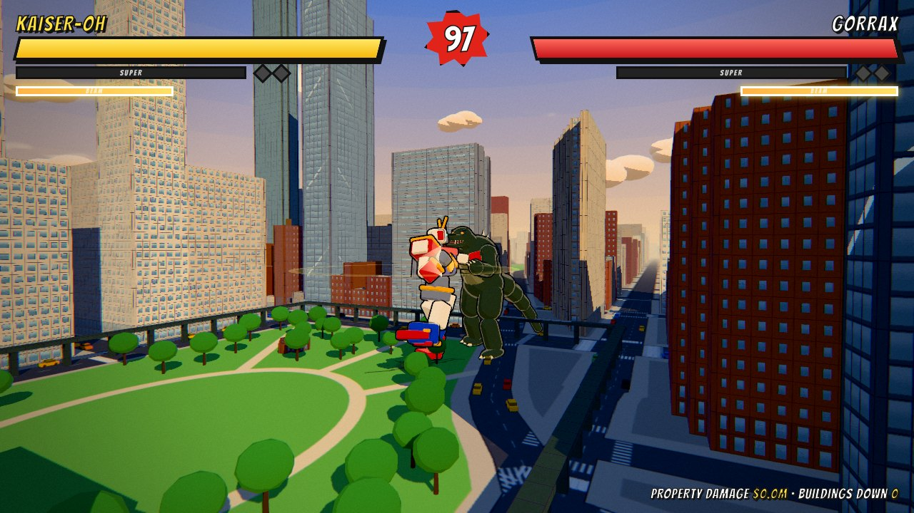
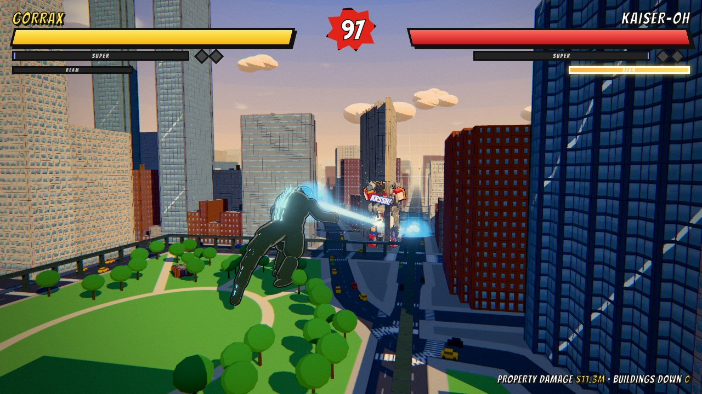
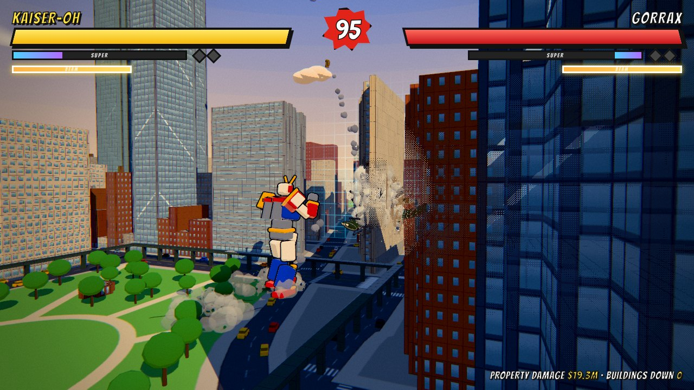
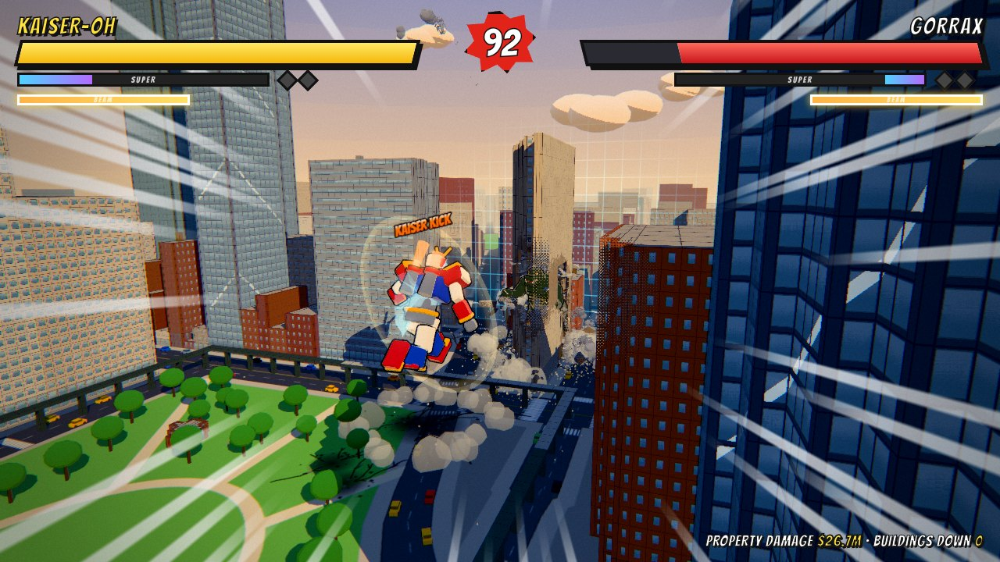
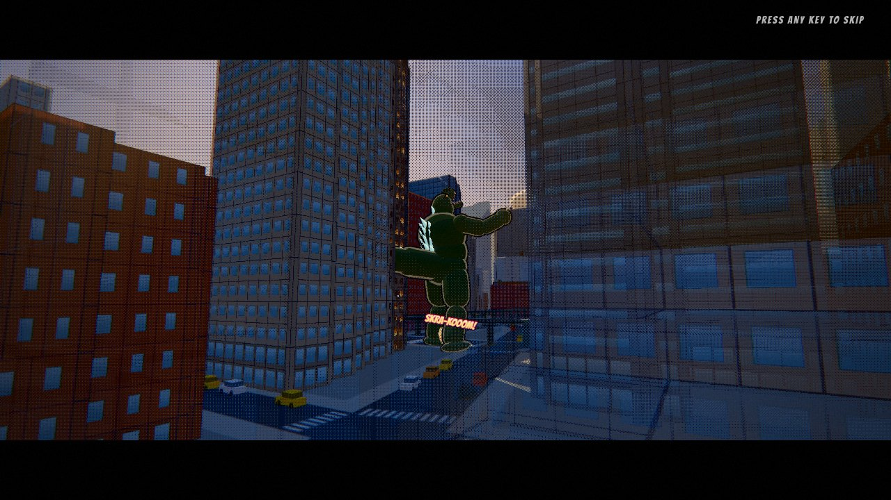

# MEGATON: a kaiju destruction fighter (tech demo)

A playable browser tech demo of a giant-monster brawl in the spirit of the Godzilla films and the
giant-robot finales of Saturday-morning sentai shows. Two 47-metre kaiju trade blows in a fully
destructible Manhattan: they wade through city blocks, throw each other through towers, cut the
skyline in half with beams and knock each other flat in the street. Every hit gets as much
juice as I could fit, and when a kaiju goes down for good, it explodes.

You play **KAISER-OH**, a red, white and gold combining robot that summons a sword for its
finisher, or **GORRAX**, an atomic lizard with glowing dorsal plates, a tail and atomic breath.
Pick one on the title screen and the bot plays the other. The characters, names and city
destruction are original; the fight is an homage.

MEGATON is a fork of [Bloodline](https://github.com/dontdothatapp/bloodline), a flying-superhero
destruction fighter. The destruction engine, city, weather, recap and juice systems carry over
from it; the fighters, their scale, movement, moves, AI, camera and effects are new.



| ATOMIC BREATH on KAISER-OH's guard | Knocked through a tower |
|---|---|
|  |  |
| **Rocket jump into a KAISER KICK** | **Round opener: the monster lands in a street canyon** |
|  |  |

**Play it:** https://dontdothatapp.github.io/kaiju/ (desktop Chrome / Edge / Firefox, a gamepad
if you have one; phones get touch controls).

**Stack:** three.js r186 (WebGL2) · Rapier 0.21 (WASM, SIMD build) · Vite · plain ES modules.
Every mesh, texture and animation is procedural. Sound is recorded samples and ElevenLabs sound
effects, with procedural sub-bass, footfalls, beams and roars layered in (see [Audio](#audio)).

## Run it

```bash
npm install
npm run dev        # open the printed URL (Chrome / Edge / Firefox, desktop GPU recommended)
npm run build      # static build in dist/ (relative paths; host anywhere)
npm run preview
```

**Host it:** `.github/workflows/pages.yml` deploys to GitHub Pages. Set Settings → Pages → Source to
"GitHub Actions", then run the workflow from the Actions tab. `node tools/build-artifact.mjs <dir>`
repackages `dist/` as a claude.ai Artifact page plus its JS chunks.

Useful URL flags:
- `?kaiju=kaiser|gorrax`: who you play (default: the robot; the title's picker remembers).
- `?fight`: skip the title. `?auto`: bot vs bot. Both skip the round opener and start the kaiju
  ~55 m apart, as the `tools/s_*.mjs` scenarios expect; `?intro` forces the opener anyway,
  `?nointro` drops it.
- `?diff=training|sparring|brutal|king` (default: sparring).
- `?quality=high|medium|low`, `?seed=1234` (a different procedural city). `?scale=0.75` pins the
  render resolution (0.5–1 of the quality's base); by default it adapts to hold 60 fps (see
  [Performance](#performance)).
- `?map=grid`: the procedural downtown. The default is `flatiron`, real Manhattan; see
  [below](#real-nyc-madison-square--flatiron).
- `?weather=golden|dusk|storm|night|random` (default: golden).
- `?pace=2`: game speed over the move data's base (also the Pace option on the title: Normal 1.5×,
  Brisk 2.25×, Fast 3×; hitstop and slow-mo stay in real time). Everything in the fight moves
  faster, nothing else changes.
- `?nomil`: no helicopters or tanks (see [The military](#the-military-srcworldmilitaryjs)).
- `?tutorial`, `?norecap`, `?mute`, `?fps` (the frame-rate readout, also a checkbox under the
  title's options: frames per second and the frame interval, simulation and physics milliseconds,
  the GPU's own frame time, the render scale when it's below 100%, the time scale during slow
  motion, and how many frames the pacing skipped). `?nopace` turns the GPU frame pacing off.

## Controls

| Keyboard / mouse | Gamepad | Action |
|---|---|---|
| W A S D | left stick | Walk toward / around him. Buildings don't stop you: you wade through them |
| Shift (tap / hold) | RT | Tap: **sidestep** hop (i-frames). Hold while walking: **run** (36 m/s, smashing through blocks); LMB while running = **tackle** |
| Space | A | **Leap**: KAISER-OH rocket-jumps, GORRAX heaves himself up. LMB / RMB in the air = **slam** down on him (KAISER KICK / BODY SLAM). Knocked down: tap to get up sooner |
| LMB / J | X | Combo ×4. KAISER-OH: jab, cross, hook, **KAISER HAMMER**. GORRAX: claw, claw, bite, **TAIL WHIP** (a full spin; the tail sweeps 40 m) |
| RMB / K (hold) | Y | Heavy; hold to **charge**. Heavy right after a combo hit = **uppercut** |
| C | LT | **STOMP**: a quake that knocks him off his feet if he's standing near you. Jump it |
| G / B | D-pad up / R3 | **BEAM**: KAISER BEAM out of the chest emblem / ATOMIC BREATH. A / D sweep it across the skyline. The gauge under your health bar refills in 9 s. Fired into his beam it's a **BEAM CLASH**: mash LMB / J (X on a pad) to push it back into him |
| E / L / MMB | B | **Grab**: out of reach, you run at him first. Then shove him through the buildings, and tap again to **throw** |
| Q / F | LB | Block; tap just before a hit to **parry** |
| R / U | RB | **Super** (full meter): KAISER-OH's **SABER FINAL STRIKE**, GORRAX's **NUCLEAR NOVA** |
| Esc · H · M | Start · Back | Pause · controls · mute |

**Gamepads:** any pad with the browser's standard mapping works, plugged in or pulled out at any
time (`src/core/input.js`, menus in `src/game/padmenu.js`). The controls panels and hints name the
connected pad's own buttons, hits rumble, and unplugging the pad mid-fight pauses.

**Phones and tablets** (`src/game/touch.js`): the left half of the screen is a floating walk
stick, with BEAM (lit when the gauge is full) and STOMP above it. The right thumb gets PUNCH,
HEAVY (hold to charge), JUMP, DASH (hold: run), GRAB, BLOCK and SUPER. `?touch` forces the layer
on a desktop.

Best of 3 rounds. **The city remembers**: destruction persists between rounds and rematches.
Every match ends with a **rank** (S to C for a win, D or F for a loss) and a score, stamped on
screen as the results come up; your best score per difficulty is remembered (see
[The report card](#the-report-card)).
After the match a **recap** of its best moments plays, then the results offer **Watch recap**,
**Rematch**, **New city**, **Rampage** and **Main menu**. **Rampage** lets your kaiju loose on
the wreckage with every move working on the buildings: walk, run, stomp, punch towers down, and
aim the beam where the camera looks.

### Tutorial

The title's **Tutorial** (`src/game/tutorial.js`, or `?tutorial`) teaches every move against the
training dummy, one step at a time: walk, punch, the combo, sidestep, run, heavy, charge, leap,
slam, stomp, block, grab, beam and super. Each step unlocks its move and waits until you've done
it; on a touch screen the buttons pop in as they're taught. The dummy closes in and swings for
BLOCK and backs off for the BEAM. Nobody gets knocked out. It ends on **Fight for real**,
**Keep practising** or **Main menu**.

## What to try

1. Hold **K** until it flashes, release next to him: aim-assist bends big knockdowns toward the
   nearest tower, so he goes in through the facade and comes out in a cloud of rubble.
2. **G** from across the park: the beam cuts through every building between you, and the street
   where it lands catches fire. Sweep it with **A** / **D**.
3. Walk (or run) straight through the base of a skyscraper: lose enough of a storey and the
   tower leans, creaks and pancakes, sometimes onto whoever's next to it.
4. **E** from across the street: you run at him and grab him. Steer him through a block, then tap
   **E** again to throw him into the next one.
5. Build the meter and press **R** next to him: KAISER-OH's sword comes down out of the sky on a
   lightning bolt; GORRAX's plates blaze before the point-blank nova.
6. When his plates light up (or the emblem starts to glow), press **G** yourself: the two beams
   meet in a ball of light between you. Mash **LMB** / **J** to shove it down his throat.
7. Swat a helicopter: they hover at head height round the monster. A fist, a tail whip, a beam
   or simply being thrown through one does it, and it spins down into whatever is underneath.
8. In **Training** he never fights back: wreck Midtown in peace, or win a match and go on a
   **Rampage**.

## The kaiju

### Scale

The fighters are about **47 m tall** (GORRAX's tail adds another 35 m behind him). Around Madison
Square, walk-ups come up to the waist, mid-rise blocks to the shoulder, and the Flatiron (87 m), Met Life
(213 m) and New York Life (187 m) still tower over both of them. Everything in the fight is sized to
that:
- reach is ~25 m centre to centre, lunges 8–34 m, knockdowns leave at 38–82 m/s;
- gravity is heavier than real (26 m/s² on your feet, 20 while knocked flying) so leaps and
  knockdowns land with a thud instead of floating, and every swing takes a beat longer than a
  person's would;
- the camera sits 90–150 m back at chest height, swinging round to a three-quarter view in close
  (from straight behind, a 47 m body hides the other one), pulling up and back when they're far
  apart, in the air or you're knocked flying, and dropping to a low angle in the street for the
  supers. It never comes closer than 70 m to your kaiju. It picks the clearer shoulder: four
  times a second it measures how many metres of standing building lie between each side's camera
  and the two of them, swings round behind you to the other side when that one has clearly been
  better for most of a second (and not again for five), and cranes up when both sides are walled
  in. Whatever still stands between the lens and either kaiju is cut away round him, a clean
  ink-rimmed pill fitted to his outline on screen (`src/world/chunkMaterial.js`), and nothing
  within 22 m of the lens is drawn at all. The heading the shot is built on turns at a capped
  rate, so when the two swap sides the camera orbits round instead of cutting through them;
  position and aim follow on critically damped springs; a KO pushes in on the one going down;
- hit sparks, shockwaves, craters, dust, the force field, the shadow frustum and sound falloff
  all scaled up to match.

### Rigs (`src/game/character.js`)

Both kaiju are built from primitives on one skeleton (the old humanoid joints plus a jaw and a
five-joint tail), so the pose blending, recorder and recap work for either.
- **KAISER-OH**: rounded boxes in red, white, blue and gold. V-crest helmet, glowing visor, big
  pauldrons, a chest emblem that charges up and fires the beam, twin back thrusters with flames
  for jumps and dives, and the KAISER SABER, hidden until the super.
- **GORRAX**: capsules and spheres. A barrel body with belly scales, thick clawed legs, a
  reptile head with a working jaw and teeth, orange eyes, and three rows of dorsal plates down
  the back and tail that light up blue for the breath.
- One pose library with per-character overrides: GORRAX hunches, his combo is claw, claw, bite and
  tail whip, and his breath rears back before leaning in.
- A **procedural walk** runs on top of whatever pose is playing: legs swing in the direction of
  travel (forward, back or sideways), knees lift in the swing phase, feet stay flat, the body
  rises over the standing leg and rolls, arms swing against the legs, and the tail waves behind.
  It emits a **footfall** at each step.

### Animation (`src/game/character.js`, `src/game/fighter.js`)

Nothing is keyframed. A move is two or three poses, and everything between and around them is
computed.
- **Springs, not blends.** Every joint chases its pose on a damped spring. A wind-up eases in; a
  strike whips out, carries a few degrees past its pose and settles; the head trails the chest,
  and each tail segment is softer and later than the one before it, so the tail is left behind by
  a turn and comes round after. Elbows, knees and the jaw are hinges with stops: no impulse or
  overshoot bends one backwards.
- **The blow lands on the frame that's held.** The strike pose goes out a few hundredths of a
  second before the hit frames open, so the limb is at full reach when the hitstop freezes it. A
  stomp's foot is on the street as the quake goes off, and the tail whip connects when the tail
  crosses in front of him.
- **Fists find their target.** Two-bone IK on the striking arm puts the fist on the other one's
  head or chest (on his arms, if his guard is up), bending the elbow when he's closer than the arm
  is long, and leaves it where it hit while he's knocked away from it. A grapple puts the hands on
  his chest. The wind-up's lunge stops at arm's length instead of chest to chest.
- **Reactions follow the blow.** Where it lands (head or body), which hand threw it and how hard
  pick the pose and send an impulse through spine, head, arms, knees and tail; the whole body
  rocks on its feet and shudders through the hitstop. A blocked hit drives the guard back into
  him; a parried swing leaves the attacker reeling; a beam holds him leaning back and shaking.
- **Feet.** The body rides its legs: the pelvis comes down or up so the lower sole is on the
  street, in a walk, a lunge, or folded over a body blow. A strike plants both feet instead of
  running on underneath it, and coming to a stop finishes the step.
- **In the air and after.** A launched kaiju flails between two poses on loose springs and
  corkscrews a little; he bounces off the street when he lands and his limbs slap down after him.
  A leap draws him out tall, and the landing folds his knees by how hard he came down.
- **At rest** he breathes, and his head turns to the other one before his body has (up at him
  when he leaps, down at him when he's on his back).

### Movement and weight (`src/game/fighter.js`)

- **Footfalls are quakes.** Each one shakes the camera (falling off with distance), rolls dust out
  from under the foot, paints a cracked footprint into the asphalt, bounces or flattens parked
  cars, knocks park trees over, derails the elevated train if the foot comes down on it, and caves
  in the ground floor of whatever building the foot lands in. KAISER-OH's joints clank.
- **Buildings don't stop you.** Legs and body wade through anything in the way: chunks detach and
  topple, and a block slows you down to a crawl. Running hits a lot harder. Take out enough of a
  tower's lower storeys and the structural integrity system brings it down.
- **Knockdowns.** A launched kaiju goes over backwards, crashes through whatever's behind him,
  lands flat on his back in a crater (cars and debris blown outward), slides and gouges a trench,
  then heaves himself back up with a moment of invulnerability.
- **The two of them collide**: they can't walk through each other, only shove.

### Moves (`src/game/moves.js`)

| | KAISER-OH | GORRAX |
|---|---|---|
| Combo | jab, cross, hook, KAISER HAMMER (both fists down) | claw, claw, bite, TAIL WHIP (a full spin, 40 m reach) |
| Heavy (charged) | rocket punch | double claw from overhead |
| Leap + attack | KAISER KICK | BODY SLAM |
| Beam | KAISER BEAM (chest emblem) | ATOMIC BREATH (the plates light up first) |
| Super | **SABER FINAL STRIKE**: the sword comes down on a lightning bolt, two slashes, the final cleave, and a moment later he explodes | **NUCLEAR NOVA**: jaws clamp on, a flurry of claws, the plates blaze, a point-blank nuclear pulse |

Shared: stomp (a quake that floors anyone standing within ~50 m; braced if blocking), uppercut,
run-in tackle, grapple and throw, block and parry, sidestep.

- **Fists, feet, tails and heads hit buildings too.** During a move's active frames the striking
  limb smashes whatever it passes through, so a punch that misses still takes a corner off a tower.
- **The beam** winds up for 0.75 s, then pours out for 1.7 s. It tracks him slowly and A / D sweep
  it. Every building along the line gets cut, and where it meets the street it throws up fire,
  sparks, scorch marks and craters. Blocking only takes chip damage, and about a second of
  sustained beam knocks him off his feet. Its gauge refills in 9 s.
- **Beam clash** (`Fighter._clashStart`, `CLASH` in `moves.js`). A beam that lands on a kaiju
  who is winding up or firing his own, facing it, doesn't hurt him: the two beams lock. So does
  a beam fired from inside the other one's hitstun, if your gauge is full (you start further
  back). A ball of light sits where they meet, spitting both colours sideways and blowing out
  windows for blocks around, and every press of an attack button shoves it toward the other
  kaiju. It ends when it reaches a mouth, or after 3.2 s with whoever is ahead: the winner's
  beam goes straight through, 20 damage and a 60 m/s launch across town. The bot mashes at 4.2,
  6 or 7.5 presses a second (Sparring, Brutal, King), and answers your beam with his own more
  often the harder he is. The clock for all of it is real time, whatever the Pace setting.
- **Rage** (`RAGE` in `moves.js`). The first time a round takes a kaiju under 30% health he gets
  his second wind for the rest of it: GORRAX's plates blaze and he roars, KAISER-OH goes into
  OVERDRIVE. Hits land 20% harder, the beam gauge refills 1.6 times as fast and a quarter of
  the super meter arrives on the spot, so a round that looked settled usually isn't.
- **Grapple:** grab, shove him through buildings for a second (steer with the stick; the
  robot hoists him overhead), then throw, with aim-assist toward the nearest tower. Within ~37 m
  the grab goes straight out; further away you **run at him** first (42 m/s, straight through
  whatever's in the way), homing on him but turning only so fast, and the grab goes out as you
  arrive. A sidestep or a leap as you get there makes it miss (nobody can be grabbed in the air),
  and so does running out of road (~1.8 s) or going past him: you stumble to a halt, wide open.
  BLOCK calls the run off; a hit knocks you out of it.

### Tokusatsu touches

- **Pyrotechnics:** sparks burst off a body on every solid hit, as on a rubber-suit set.
- **Kaiju explode when they lose:** a K.O.'d kaiju goes down, lies still for a moment, then blows
  up in a fireball with black smoke, sparks raining down and everything around it blown outward.
- **Speech bubbles**: few and far between. GORRAX keeps quiet during a round (his roars say it);
  KAISER-OH's pilots get a battle cry at the bell and "Stay down, monster!" when he floors you.
  The bot gets a line if it wins the match.
- **Roars and poses:** between exchanges the bot backs off and roars (windows blow out around his
  head) or strikes the sentai pose. Pick a kaiju on the title and it makes an entrance.
- **Round opener** (`src/game/intro.js`): an aerial establishing shot of New York, then the other
  kaiju makes his entrance in front of the Flatiron and yours in Madison Square Park, each his
  own way. KAISER-OH flies in: a powered descent on an angle from high over the city, thrusters
  braking all the way, a hero landing on one knee in a crater, then he stands up into his guard.
  GORRAX comes on foot: he charges down the clearest street behind his mark (through whatever is
  in the way), every footfall a quake, plants himself on it and roars into the lens. The last
  shot cranes round behind you to where the fight camera picks up. Rounds 2 and 3 pick up where
  the last one ended: the loser gets up where he went down, both walk back to their corners
  (about 70 m apart, on open ground) facing each other, the monster roars and the robot strikes
  its pose, and the bell goes. Any key or tap skips straight to them standing on their marks.

### The military (`src/world/military.js`)

The army turns up, as it does in every one of these films, and is about as much use. Attack
helicopters take up stations round the monster at chest-to-head height, low over a street or a
low roof where there is one, hold them for a few seconds firing the chin gun (and every third
pass a rocket), then move to another; towers on the way are climbed over. Tanks patrol the
avenues and lob shells. After dark each helicopter keeps a searchlight on him.

- **They hunt the monster**: GORRAX during a fight, whichever kaiju is rampaging after it. Their
  fire is sparks off the suit: about 7 health over a whole round, never the last of it, no
  flinch. `?nomil` sends them home.
- **They are there to be swatted.** A fist, a claw or a tail in its active frames, a beam, a
  kaiju flying past, a quake, an explosion or a foot coming down takes one out
  (`hitSphere` / `hitRay` / `blast`, called by the fighters and the effect recipes). A downed
  helicopter spins away trailing smoke and blows a hole in whatever it lands on; a stepped-on
  tank is flat, any other wreck loses its turret. Each one is worth a little super meter, $14M
  on the damage bill and a few points on the report card.
- **Replacements keep coming**: the next helicopter flies in from outside the city after ten
  seconds or so, the next tank appears on a street well away from both kaiju.
- Nothing here is a physics body: four instanced meshes (helicopter, rotor, hull, turret) moved
  by hand, plus a small pool of slugs for rockets and shells. The recorder samples their
  matrices with the debris, so they are in the recap too.

### The report card

When a match ends it is scored (`Game._report`): 5,000 for the win (1,000 per round in a loss),
up to 1,500 a round for the health you kept and 1,000 for the clock, style (best combo, clashes
won, supers, parries, throws, swatted helicopters and tanks) and mayhem (buildings down, the
damage bill). A loss counts half. The rank comes from that total: **S** from 13,000, **A** from
10,500, **B** from 8,500, **C** for any other win, **D** or **F** for a loss. The difficulty then
multiplies the score (Brutal 1.5×, Kaiju King 2×) but not the rank, and the best score per
difficulty is kept in `localStorage`. Training isn't scored.

## The destruction system

Everything breakable (about 29k chunks, 100+ structures plus the elevated viaduct) is drawn as
**one `InstancedMesh` per building** (so each one culls against the camera and the shadow camera
on its own). A building is a grid of chunks:
- thin facade panels on the perimeter;
- corner columns;
- 3×3-cell floor slabs inside;
- rooftop clutter on top.

Setback towers get two or three tiers.

**1. Impact gradient** (`src/world/structures.js → impact()`). Every hit is a sphere. Chunks are
classified by distance into concentric zones:

| Zone | What happens | Implementation |
|---|---|---|
| core | pulverized | non-physics rubble pebbles + dust |
| mid | Voronoi-fractured | 5–8 convex-hull shards from a pre-computed library |
| outer | detached whole | one rigid body |
| shatter ring | windows blow out | glass shards + broken-window shader state |
| crack ring | soot, radial cracks, cracked glass | shader-only damage |

At most 3 fractures per impact; the rest detach or pulverize. This follows the shipped-game
consensus: pre-fracture at load time and show every scale at once.

Each chunk remembers the impact that reached it hardest (point and radius, the `aHit`
attribute). The shader fades the damage out from that point, so a hole gets soot in two comic
bands, inked cracks radiating across the facade and a ring around the crater. Each window judges
the damage at its own centre: blown out near the hole, spiderweb-cracked further out, intact
beyond. Debris keeps the impact, so a chunk's damage carries over when it breaks off.

**2. Seamless hand-off** (`src/world/chunkMaterial.js`). A single toon shader draws the facade in the
chunk's *parent* space:
- windows, mullions, brick courses and ink edges;
- glass with comic glints;
- blown-out windows.

A chunk that turns into debris therefore looks identical on the frame it detaches. Voronoi shards
show their slice of the window, and freshly cut faces show raw concrete. Merged collapse slabs
repeat the window pattern per original cell. A derivative-based LOD fades the pattern to its
average colour at distance, so there's no moiré.

**3. Structural integrity**. Each storey keeps its wall ratio; a storey below ~42% (±12% per
building) fails. A flood fill from the ground catches anything left hanging (severed corners, cut
viaduct spans).

**4. Collapses that read as heavy**:
- a 0.45–0.75 s **wind-up**: metal groan, dust trickling out of the failing storey, a few bits shedding;
- the failure **propagates outward** at 18–30 m/s instead of everything letting go at once;
- every released piece gets the same rigid-rotation velocity field `v = ω × (p − pivot)`, so the upper
  section **tips over as one mass** toward the damaged side;
- the section falls as a few heavy bodies: whole floor plates, facade strips up to 6 panels × 2
  storeys, and 4-storey corner columns;
- if the falling mass is large relative to what's below, the lower storeys are **crushed one after
  another**, about one per free-fall interval, each with a dust ring, a boom, some shake and dust
  blasting out of its windows. That's the pancake;
- the pancake stops one to four storeys up, and the **stump** gets a ragged, scorched top;
- falling facades lose most of their glass, which rains off them;
- the **dust is timed to the fall** (real gravity): a plume boils up the height the mass still
  spans, the base keeps pushing billows into the street while it pours down, and when the top
  lands a surge rolls out down the street canyons. Collapse clouds have a smoke budget of their
  own, so the dust a tower makes can't thin out its own cloud;
- the **rubble piles up** in the heightfield over the footprint in three goes, with painted
  rubble and a film of dust on the streets around it;
- a **pall of dust** hangs over the site for a quarter of a minute after the surge has rolled
  away, and the wreck **goes on smoking** for a minute or so: a column of black smoke leaning
  downwind, small fires at its foot, embers going up with it, all dying down (`Destruction.smolderAt`;
  the spot where a finisher's explosion went off smokes too). Up to seven wrecks smoke at once.

**5. Progressive crumble** (`src/physics/debris.js`). Contact-force events, normalized by mass, break
pieces on hard landings:
- a big slab splits in halves along its longest axis;
- then quarters;
- then single panels;
- then Voronoi shards.

Each break adds only a few bodies, so a collapse never bursts the budget at once. Every hard
knock also cracks a piece up a little more, and wrecked pieces gather dust on whatever faces up,
so settled rubble looks like rubble. Big collapse pieces trail dust on the way down and throw out
a skirt of dust (and a bit of shake) when they hit the street.

**6. Budgets and freezing**. Rapier bodies are capped at 420 / 300 / 170 (high / medium / low).
An untouched building is a few fixed box colliders; the first hit splits those into one box per
storey, and only the storeys that lose chunks get a collider per chunk (debris never reaches the
inside of an intact storey), so a long match stays at ~1,500 colliders instead of tens of thousands.
Settled pieces are **frozen into static rubble**: the body is removed but the instance stays, so the
city accumulates real debris piles. Later shockwaves **re-wake** nearby frozen rubble through a
spatial hash. Collapses may evict small in-flight shards (swapped for pebbles) to make room for the
heavy pieces.

Only pieces that have been slow for a while are parked to make room (a slab just let go, or at the
top of its arc, is slow too: parking those left floor plates hanging in the sky after a tower had
gone). A collapse piece that finds no room for a body **falls without one**: free fall and a
tumble, down to the street or the top of whatever still stands under it, where it flops flat and
stays; where rubble is already piled high it breaks up into pebbles and dust instead. And parked
rubble is **checked for support**, a couple of dozen pieces a frame: one whose storey, wall or
pile has since gone falls again the same way.

**7. Ground**. A 280×280 deformable heightfield (mesh and Rapier collider share the data) takes:
- craters: a bowl plus a raised lip;
- skid trenches when a body grazes the street at speed;
- cracks, scorch and blood painted into the street canvas.

**8. Props**:
- About 150 parked cars stay `Fixed` until a shockwave or body disturbs them. They then become
  dynamic, get wrecked (some explode) and refreeze when calm.
- The elevated train is kinematic on a destructible viaduct. Hit a car at speed, or destroy the
  track under it, and every car derails with its momentum.

### Keeping the fight readable

Early playtesting showed the screen spending most of a fight buried in dust. The fixes
(`src/fx/smoke.js`, `src/fx/fx.js`):
- Smoke has two layers with the same cel shading. Hit puffs, fire and black smoke stay opaque,
  inked billows; the big **dust clouds** from breaks and collapses are **see-through**.
- Smoke clears out of a **visibility tunnel** from the camera to each fighter's chest (dust fades,
  opaque puffs halftone-dither), so both kaiju stay visible through any cloud.
- Smoke clears within a few metres of the camera, and a puff that would swallow the camera is
  culled outright, so it never fills the screen.
- Chunk-break dust is smaller and shorter-lived, and dust spawns thin out as the smoke pool fills.
  A collapse still gets its big cloud, but it settles in seconds.
- Buildings get **cutaways** instead (`src/world/chunkMaterial.js`): each frame both kaiju are
  projected through the real camera (the portrait view offset included) and a pill on screen is
  fitted round each one's joints, padded by his bulk. Any building or debris fragment inside it
  and nearer the lens than he is isn't drawn; a thin ink rim just outside the cut makes it read
  as drawn rather than broken, and everything else stays fully opaque. A cutaway opens over 0.2 s
  when a building first gets in the way and closes once none does; flung-out limbs widen it at
  once and it settles back calmly. In free roam the beaten one only gets one within 260 m. The
  shadow pass doesn't see any of it.

### Line work and grounding

- **Ink outlines** on everything, not only the fighters (`src/render/post.js`). Where one thing
  ends in front of another, the depth buffer steps. `1 / z` runs linearly across any flat surface
  on screen whatever its angle, so its second difference is zero on a street or a wall seen
  edge-on and jumps at a silhouette; scaled by `z²` that jump is the depth step in metres, and a
  step big enough for its distance draws a line. It rides on the scene's MSAA resolve (five depth
  taps, no extra pass), thins out into the fog, and fades under dust: the see-through smoke
  layers leave their transmittance in the frame's alpha channel, so a building's outline isn't
  drawn sharp on top of the cloud in front of it. High and medium quality.
- **Grounding.** The foot of every building, and the rubble in the street, sits in a cooler,
  darker band that fades out a few storeys up (the chunk shader), and the street canvas is painted
  darker toward every footprint: the towers stand on the ground instead of floating on it.
- Dust billows are round (320 faces) and thin out toward their outline, so a cloud reads as one
  mass, not as a pile of balls; impact flashes are balls of light, bright at the heart.

### Weather and light

A match is lit by one of four looks (`src/render/weather.js`): **Golden hour** (the default),
**Crimson dusk**, a **Thunderstorm** and **Night**. The title's **Weather** menu picks another, or
Random for a new one each match. One set of numbers per look drives:
- the sun (the moon at night): direction, colour and strength, plus the sky light;
- the sky: gradient, a drifting cel-shaded cloud deck lit from the sun's side, the disc and its
  glow, stars;
- fog, exposure, bloom and a colour grade (shadows and highlights each pulled toward a tint);
- **light shafts** through gaps in the skyline (a post pass that marches toward the sun and
  gathers open sky from the depth buffer);
- **lit windows** after dark (the skyline glitters, even in the far filler blocks) and **fires** in
  the blown-out windows around impacts, cel flames with a hot core;
- a rim light on the fighters, so they stand out from a dark city;
- how heavy the ink outlines are (lighter at night), and where they fade into the fog;
- the dust's colour, so a cloud doesn't glow at night;
- **rain** (streaks in a box around the camera, animated on the GPU, with a rain bed in the mix)
  and **lightning**: a jagged, branching bolt into the skyline, the city flashing and thunder
  arriving at the speed of sound.

The final round pushes the look further: golden hour sinks toward dusk, dusk into the blue hour,
the storm gets heavier (more rain, more lightning), and the night burns harder. On Random each
rematch rolls a new sky over the same wrecked city. Every change eases in over a few seconds.

### Match recap

After the winner's banner, the match's best moments come back as a short letterboxed film,
shot from new angles (`src/game/recorder.js`, `src/game/recap.js`). It runs 15–30 seconds; any
key or tap skips to the results, and **Watch recap** plays it again.

- **Recording.** The recorder never steers the simulation. After each step it samples what's on
  screen, and it listens in on the systems that change it:
  - the fighters' full pose every frame (root, joints, arm smear, hit flash, bruises, trails);
  - the instance matrices of live debris, tumbling cars, the train and the military's
    helicopters and tanks, 20 times a second;
  - for the whole match, when each city chunk broke and when debris pieces spawned, settled or
    vanished;
  - every particle, shockwave and comic-word spawn, beam, sound, screen flash and camera shake,
    as the call that made it.

  Moving data older than 8 seconds is dropped unless it belongs to a highlight, so a match holds
  a few MB.
- **Highlights.** The game marks big knockdowns, crashes through buildings, street slams, leap
  slams, supers, beam clashes, the train, building collapses (landmarks count extra) and KOs. Moments close
  together merge into one clip; the best seven are kept while the match runs. The recap takes the
  final KO plus the best of the rest that fit in about 30 seconds, in match order.
- **Playback.** The simulation stands still. For each clip the recap rebuilds the city as it
  was: standing chunks from their break times, debris from the match-start snapshot plus every
  change since, rubble mounds rewound to when they were raised. It then replays fighters, debris,
  effects and sounds against its own camera.
  Afterwards everything is put back as it was, so a rematch continues in the same wrecked city.
- **Direction.** Each clip is cut into shots around its two or three biggest moments:
  - a wide orbit or a low angle on the way in;
  - a side-on close-up of each big hit, slowed right down;
  - a tracking shot alongside whoever's been knocked flying;
  - a tower coming down, from a helicopter above the roofs around it (any lower, and in
    Midtown the lens stares at the building next door);
  - the leap-and-slam from above and behind.

  The best hit of the match gets a second look from the reverse angle. Camera spots are checked
  against the city *as it was at that moment* (no lens inside a wall, under a roof or in a park
  tree), and hit flashes are resized for the new lens.

### Beyond the arena

The destructible core is a 6×6-block downtown. Around it (`createSkyline` in
`src/world/city.js`):
- the streets (asphalt, sidewalks, curbs, lane markings) continue across the outer floor;
- nine rings of non-destructible filler blocks with the same facades, tallest next to the arena and
  thinning out toward the horizon;
- far skyline silhouettes and blinking aircraft-warning lights sit in the haze.

The playable area is a square. When a fighter nears its edge, a patch of glowing "force
field" fades in around them (`src/world/boundary.js`), so the limit reads as part of the world
rather than an invisible wall.

### Real NYC: Madison Square / Flatiron

The default map drops the fight into real Manhattan (the procedural downtown is one click away
in the City menu): the 456 m arena is centred on Madison Square
Park, with the Flatiron Building's wedge, the Met Life Tower and the New York Life Building
inside it. The Empire State and the Midtown skyline rise to the north, between the Hudson and the
East River. The elevated train loops the park along 5th Ave, 26th St, Madison Ave and 23rd St.

- **Data.** `tools/extract-nyc-map.mjs` cuts the area out of
  [Slop New York](https://github.com/mrdoob/slop-newyork)'s processed NYC Open Data. That repo
  packs building footprints and roof heights into a compact binary of zigzag-varint deltas, plus
  curb-line blocks, street centrelines, parks and shorelines. The extractor writes
  `src/world/maps/flatiron.json` in this game's frame: metres, axes turned 29° so the street grid
  is axis-aligned, origin at the park. The file is 339 KB (106 KB gzipped) and loads only when the
  map is picked.
- **Buildings** (`src/world/realCity.js`):
  - **Footprints.** The 221 footprints in the arena are rasterised onto one shared 3 m grid,
    tallest first, so neighbours never overlap.
  - **Walls.** Each building gets 1 m wall strips only on the cell sides that have a face, so
    wedges and L-shapes keep the usual wall / corner / slab anatomy. Collapse, pancaking and
    integrity work unchanged.
  - **Party walls.** They stay out while a neighbour hides them. Above the neighbour's roof they
    are blank brick on walk-ups, and windows on towers.
  - **Setbacks.** Big pre-war towers get 1916-zoning setbacks.
  - **Intact colliders.** A few boxes hug each shape instead of one bounding box.
- **Chunk budget.** Real Manhattan is far denser than the procedural blocks, so tall buildings use
  7.2 m double-storey chunks and neighbouring facade panels pair up. The window pattern stays every
  3 m × 3.6 m through a per-chunk `cell` override. That gives about 40k chunks on high versus 29k
  procedural, and 25k on low versus 19k.
- **Ground.** Real blocks with exact 4.6 m sidewalks, NYC lane paint (double yellow on two-way
  streets), zebra crossings wherever two centrelines cross, parked cars on real curbs, and a
  leafy park whose trees get stripped by ground blasts. A 4 km outer plane holds the surrounding
  blocks, the boroughs and the rivers.
- **Landmarks.** The survey has one roof height per footprint. The Flatiron and the Met Life Tower
  get their colours; Met Life and New York Life get gilded pyramid crowns. The Empire State is
  hand-built (the survey's version is a single 378 m box), as Slop New York does.

Footprints, roof heights, street centrelines, parks and borough boundaries come from
[NYC Open Data](https://opendata.cityofnewyork.us/), processed by Slop New York (MIT).

### Things measured during development (and the fixes)

- **The first contact of a new kind stalls Chrome for about 100 ms.** Chrome compiles WebAssembly
  lazily, so this happens the first time hull-vs-hull or hull-vs-heightfield contacts run. Fix: a
  throwaway warm-up simulation at load (`Physics.warmup`).
- **"Sleeping" bodies were costing 15 ms per step.** Rebuilding colliders woke them, and Rapier 0.21
  puts whole islands to sleep together. Fix: parked cars are `Fixed` until disturbed, and debris
  freezes based on its *own* velocity, not `isSleeping()`.
- **Thin floor-slab slivers tunnel through the heightfield.** Fix: slabs never Voronoi-fracture, and a
  safety net pops anything under the ground back up and parks it.
- **Collapse cost.** p50 of 4 ms of CPU simulation (p99 10 ms) for a full 30-storey collapse on the
  4-core container used for development, which is slower than a typical desktop. The SIMD Rapier
  build is 10–30% faster than the scalar one.
- **Lazy collider refinement used to add ~2,000 fixed colliders per touched tower** (8 ms, then a
  22 ms physics step while the broadphase absorbed them; 41k colliders and 40 ms steps once every
  building had been touched). Fix: per-storey boxes, refined per chunk only where chunks went.
- **The integrity flood fill (6 ms on a big tower) ran every frame a chunk broke**, which while
  wading through a block is every frame. Fix: one structure per frame, each at most every 0.2 s.
- **Every footstep re-uploaded the whole 2048² ground canvas** (16 MB, up to 8 times a second,
  6 ms each). Fix: the painters grow a dirty rectangle and only that goes up (`texSubImage2D`).
- **Below 40 fps the physics took two substeps**, doubling its cost exactly when the frame was
  already late. Fix: one coarser step when the step itself is what's slow (it always covers the
  whole frame, so debris never falls in slow motion).
- **The hitstop held the wrong frame.** The strike pose and the hit both started on the first hit
  frame, so the freeze caught the fist about two-thirds of the way out; the flash, the star and
  the sparks were frozen with the world on their brightest frame, and the white hit flash lasted
  as long as the freeze, so the blow itself was a white shape. Fix: the swing starts early enough
  to be at full reach, hit effects run in real time through the freeze, and the flash is a frame
  or two.
- **Poses that stuck.** A parried punch stayed out, and the kneel after a missed slam stayed on,
  until the next move: he walked around like that. Fix: a stagger ends back in the guard.
- **Hovering and sinking.** Only the hero landing lowered the body onto its legs; a deep stance
  hovered up to 3 m over the street and the idle stood 1 m into it. Fix: the pelvis always follows
  the lower sole.
- **A smooth frame counter over a game in slow motion.** The GPU runs behind the JavaScript, and
  when it can't keep up the browser can keep calling `requestAnimationFrame` at full rate while
  finished frames queue up and reach the screen late. Fix: a fence after each drawn frame; with
  three frames still unfinished the next one isn't drawn (the simulation still runs), and the fence
  timings give the dynamic resolution a GPU frame time the frame interval alone never showed.

## Performance

The GPU is where the frame goes: the city is 40k instanced chunks on high, each drawn through the
facade shader, twice (the shadow pass). What keeps that under control (`src/world/structures.js`,
`src/world/chunkMaterial.js`, `src/render/post.js`, `src/main.js`):

- **One mesh per building, and the far skyline in 400 m cells**, so three.js frustum-culls each
  against the camera and the shadow camera; a typical shot submits a third of the chunks instead
  of all of them, and only skyline cells near the arena cast shadows.
- **Interior floor slabs** (over a third of all chunks) stay out of the draw until a building is
  first touched: nothing can see them through an intact facade.
- **Three variants of the chunk shader.** The cut round the lens and the cutaways toward the
  fighters need `discard`, which turns off early depth rejection for a whole draw. Only the
  buildings that actually reach into a cutaway (or hug the camera) use that variant, picked every
  frame; everything else uses a plain one, and buildings beyond 350 m one without the crack, fire
  and spiderweb detail that would be sub-pixel anyway. Debris always draws with the cutaways.
- **Resolution.** High renders at 1.5× device pixels at most, medium 1.25×, with the drawing
  buffer's long side capped near 2560 px (a 2× laptop or a 4K monitor was drawing 4× the pixels of
  1080p through the post stack). On top of that **dynamic resolution** watches the frame interval:
  when frames run long while the CPU side is cheap (so it's the GPU), the render scale steps down
  to as low as 0.5; when frames come in under 16.7 ms for a couple of seconds it steps back up.
  The canvas keeps its size, the HUD is DOM and stays sharp. `?scale=` pins it. A GPU fence per
  frame tells how far behind the GPU is: frames are skipped rather than queued when it falls three
  behind, and its measured frame time drives the scale too.
- **Post stack.** The FX pass tone-maps and converts to sRGB itself (no separate OutputPass), and
  the shadow map is 2048² (22 cm a texel over the fight; a stepped toon ramp doesn't show more).
- **CPU.** Per-storey colliders, throttled integrity checks, dirty-rectangle ground uploads and
  single physics substeps under load, all listed under
  [Things measured](#things-measured-during-development-and-the-fixes).

Measured on the dev container with `tools/shot.mjs` (headless Chromium, software GL, 960×540):
software raster time for a mid-fight frame fell from 3.0 s to 2.2 s, the city's share of it from
66% to 50%, and a bot-vs-bot match holds ~1,400 physics colliders where it used to climb past
4,000 within a minute. `window.__stats` shows the live frame rate, simulation and physics
milliseconds and the current render scale.

## The juice catalog

One **strength** value per hit drives every channel together (`src/game/juice.js`), so a jab and a
skyscraper-ending haymaker stay proportional:

| Channel | Implementation |
|---|---|
| Hitstop | Tiered by hit and a little heavier than a human fighter's: ~6 frames for jabs, ~12 for heavies, 14–20 plus slow-mo for knockdowns and finishers. The world freezes; shake, text, sparks, flashes and rings run in real time, and the one who was hit shudders. |
| Camera | Trauma-based shake (`trauma²` × Perlin noise, rotation-led, per Eiserloh) and a directional kick spring, both played at 15% of the tuned amplitude (`SHAKE_SCALE`) so the fight stays readable, FOV punch, every footfall felt by distance, a wider shot when you're knocked flying, a push-in on a KO, a low-angle cinematic with letterbox for supers. It follows on critically damped springs and keeps to the shoulder with the clearer view. |
| Screen | Chromatic-aberration kick (growing toward the corners, so the middle of the frame stays sharp), radial zoom blur toward the impact (its taps jittered per pixel, so it streaks instead of ghosting), anime speed lines when running or diving, 2–3-frame **impact frames**, flashes, red damage vignette. |
| Time | Slow-mo with eased recovery: KO, parry, charged hits, super finishers. Audio gets muffled and pitched down to match. |
| Bodies | Spring-driven poses with follow-through, fists that land by IK, reactions by where and how hard the blow lands, anime **smear frames** (stretched striking arm), a one- or two-frame white hit flash, squash and stretch, bruising shader as health drops, plates / emblem glowing as a beam charges. |
| World | Tokusatsu spark bursts, impact stars, flash spheres, shockwave rings, beams, fireballs, cel-shaded smoke with inked rims, rubble, glass, craters and footprints, comic onomatopoeia and move names ("ATOMIC BREATH!"). |
| UI | Lagging chip damage, shaking bars, super meter and beam gauge, combo counter with grades, the beam-clash tug-of-war bar, a burning health bar in a rage, property-damage counter (it climbs into the billions), toasts, speech bubbles, the rank stamp. |
| Audio | Recorded punches with procedural sub thumps, footfall thuds, beam roar, explosions, voice shouts and roars, ElevenLabs effects for destruction; a metal soundtrack that ducks under big hits. |
| Haptics | Gamepad dual-rumble scaled by hit strength (and a little for your own footsteps). |

## Audio

`AudioEngine` (`src/core/audio.js`) plays recorded samples for every sound group it finds in
`public/sfx/` (full list and sources in `public/sfx/README.md`), layered with procedural sound:
- **Fist hits:** ["37 hits/punches"](https://opengameart.org/content/37-hitspunches) by
  Independent.nu (CC0) with procedural sub thumps under them.
- **Voices:** both fighters reuse Bloodline's ElevenLabs voice sets. KAISER-OH gets the fiery young
  shonen hero, as its pilot shouting from the cockpit. GORRAX gets the deep villain played at
  ~0.6× speed, so his grunts and screams come out as growls and roars.
- **Kaiju sounds** are procedural (`AudioEngine.footstep / beamStart / roar / explosion`):
  - footfalls: a sub-bass thud with a rumble tail and a crunch of asphalt; KAISER-OH's joints
    clank (the metal hit, pitched way down);
  - the beam: band-passed roaring noise over a buzzing saw, with a wobble;
  - GORRAX's roar: his deepest voice line slowed to half speed over a growling saw and a hiss;
  - explosions: a falling sub boom, a brown-noise blast and crumbling masonry.
- **Destruction, impacts and movement** (crumble, glass, collapse, creaks, smash-through, ground
  slams, whooshes, skids) are ElevenLabs sound effects made by `tools/elevenlabs-sfx.mjs`, as are
  the stingers (FIGHT!, super ready, combo streaks, parry, victory, the charge build-up).
- Sound falls off over kaiju distances (the camera is ~100 m away). The mix runs through a glue
  compressor and a limiter; stingers and voices keep their pitch in slow-mo.
- `tools/sfx-index.mjs` writes `public/sfx/index.json` before `npm run dev` / `npm run build`.
  On iPhones every `.ogg` has an AAC twin (`node tools/ogg-twins.mjs`).

**Soundtrack** (`public/music/`, from Woffels'
[Metal OST Asset Pack](https://woffels.itch.io/metal-ost-asset-pack-noitavaino), CC BY): an intro
theme on the title and during the rampage, a Doom-style riff for the rounds, and a brutal theme
on the results screen. Pause → **MUSIC** toggles it; **M** mutes everything.

## Research notes (sources)

The design leaned on these; full notes in the commit history.

- Pre-fracture rather than runtime CSG; hide seams until damage: Embark's THE FINALS pipeline,
  [80.lv](https://80.lv/articles/how-embark-studios-built-procedural-environments-for-the-finals-using-houdini);
  GDC 2024 [*Engineering Mayhem*](https://media.gdcvault.com/gdc2024/Slides/GDC+slide+presentations/Isaksson_Mans_Engineering+Mayham+Technical.pdf).
- "Every scale at once", big bodies down to dust: Remedy's *Control*,
  [Game Developer](https://www.gamedeveloper.com/production/using-procedural-destruction-to-unleash-chaos-in-i-control-i-).
- Never pop debris; remove after sleep, inside dust: Unreal Chaos geometry collections
  ([docs](https://dev.epicgames.com/documentation/en-us/unreal-engine/python-api/class/GeometryCollection)).
- Integrity is what players notice, both the floating-voxel criticism and the praise for buckling
  floors: [PC Gamer on Teardown](https://www.pcgamer.com/teardown-review/),
  [Game Informer on Red Faction Guerrilla](https://gameinformer.com/games/red_faction_guerrilla/b/xbox360/archive/2009/09/22/review.aspx);
  thresholds per NVIDIA Blast's [stress solver](https://github.com/NVIDIA-Omniverse/PhysX/blob/main/blast/include/extensions/stress/NvBlastExtStressSolver.h).
- Scale reads through timing, so stay near real gravity at real scale:
  [miniature filming formula](https://cinematography.net/edited-pages/MiniatureFormula.htm).
- Rapier 0.21 behaviour (island sleeping, CCD, group filtering in the broad phase):
  [CHANGELOG](https://github.com/dimforge/rapier/blob/master/CHANGELOG.md),
  [heightfield layout](https://github.com/dimforge/parry/blob/master/src/shape/heightfield3.rs).
- Hitstop tiers: [KOF XIII](https://srk.shib.live/w/The_King_of_Fighters_XIII/Character_States/Hitstun_Blockstun_state),
  [Smash hitlag](https://www.ssbwiki.com/Hitlag); a study found 0.1–0.2 s of hitstop felt best
  ([IEICE](https://ken.ieice.org/ken/paper/20230315OCSt/eng/)); Sakurai on shaking the victim more
  ([recap](https://nintendowire.com/news/2022/12/12/this-week-in-sakurai-12-5-12-11-fine-tuning-hit-stop-and-cheating-the-system/)).
- Camera shake: Squirrel Eiserloh, *Juicing Your Cameras With Math*, GDC 2016
  ([video](https://www.gamedeveloper.com/programming/video-sprucing-up-cameras-with-math)).

- Scale through the low angle: the kaiju films' miniature work, shot from street level, is why the
  camera here sits at chest height and looks up for the supers.

## Code map

```
src/main.js                boot, main loop, test hooks
src/core/                  context, time (hitstop/slow-mo), input (kb/mouse/pad), audio, math
src/render/                renderer + sky + clouds, toon ramps + hull outlines, post FX stack (ink outlines, light shafts, grade), weather
src/world/city.js          procedural downtown (blocks, setback towers) + outer filler city
src/world/realCity.js      real-map buildings: footprints -> cells, party walls, setbacks, skyline, landmarks
src/world/maps/            real map data (tools/extract-nyc-map.mjs)
src/world/structures.js    chunk store, impact gradient, integrity, collapse, pancake
src/world/chunkMaterial.js facade/fracture shader (parent-space patterns), the cutaways round both kaiju
src/world/ground.js        deformable heightfield, craters, footprints, painted streets, outer ground
src/world/                 boundary (force field), props (parked cars), train (elevated viaduct), trees
src/world/military.js      attack helicopters and tanks: stations, fire, getting swatted, searchlights
src/physics/               Rapier wrapper + warm-up, debris budget/freeze/crumble, body-less falls + support checks, Voronoi library
src/fx/                    pebbles/glass/sparks, cel smoke, shockwaves, comic text, trails, beams (beam.js)
src/fx/fx.js               effect recipes: hits, ground impacts, footfalls, pyrotechnics, fireballs, explosions, sword slashes
src/game/character.js      the two kaiju rigs, pose library, joint springs, arm IK, walk cycle, glow, thrusters, sword
src/game/fighter.js        kaiju state machine: walk / run / leap / slam, attacks, beam, grapple, supers, knockdowns
src/game/moves.js          frame data, speeds, beam tuning, per-kaiju move variants
src/game/                  AI, camera, juice, round opener (intro.js), touch controls, pad menus, tutorial, HUD, game flow
src/game/recorder.js       match recording + highlight marks; recap.js plays them back as a film
public/sfx/                samples + index.json (see Audio)
public/music/              soundtrack (menu, fight, results)
tools/                     headless Playwright scenarios (screenshots, perf, soak tests), sfx indexer, NYC map extractor
```

## Testing

`tools/shot.mjs <url> <out.png> [waitMs] [scenario.mjs]` drives headless Chromium. Scenarios call
`window.__test.advance(seconds)`, which steps the simulation deterministically without rendering;
software GL runs at about 1 fps. Useful ones:
- `tools/s_kaiju.mjs`: every move once against the dummy, logging both fighters' states, the
  chunks destroyed and the debris bodies (`?kaiju=gorrax` for the monster);
- `tools/s_soak.mjs`: 100 s of bot vs bot, checking for stuck states and NaNs;
- `tools/s_docs.mjs`: the README screenshots;
- tower collapses (`collapseTower()`), the train, the NYC map and the recap, carried over from
  Bloodline.

```bash
node tools/shot.mjs "http://localhost:5173/?fight&norender&mute" /tmp/k.png 4000 tools/s_kaiju.mjs
node tools/shot.mjs "http://localhost:5173/?fight&auto&norender&mute" /tmp/s.png 4000 tools/s_soak.mjs
```

## Known limitations / next steps

- The kaiju are primitive-built and procedurally animated, not skinned meshes; the walk cycle is
  a layer on top of the poses, so feet can slide a little on turns and through a lunge. Only the
  arms have IK: a bite, a tail or a kick goes where its pose sends it.
- Both voices are Bloodline's ElevenLabs sets: GORRAX's are pitched down, KAISER-OH's are a
  pilot's. Dedicated roar and servo recordings would sell the scale even better.
- Interiors are empty apart from the floor slabs, so wading through a building shows its floors
  and facades but no furniture.
- Debris doesn't collide with *intact* neighbouring buildings until those buildings take damage
  (lazy collider refinement).
- Pieces that fall without a physics body (a collapse that outruns the body budget, rubble whose
  support has gone) pass through each other and through the rubble on the way down; they only
  come to rest on the street, a standing chunk or a low pile.
- The ink outlines follow silhouettes, not creases (there's no normal buffer), and aren't drawn
  on low quality, which has no depth texture to read.
- The robot doesn't combine from smaller vehicles at the round start; it just flies in.
- The military's units aren't physics bodies: a wreck doesn't tumble or get kicked around, and
  shells and rockets pass through buildings on their way to the monster. There are no jets yet.
- Single-player against the bot only. Local 2P would mostly need a second input mapping and a
  shared camera.
- GPU cost was not profiled on real hardware (the dev container renders in software); the
  [Performance](#performance) numbers come from a software rasterizer. If a machine struggles, use
  `?quality=medium` or `low`, or pin a lower `?scale=`.
